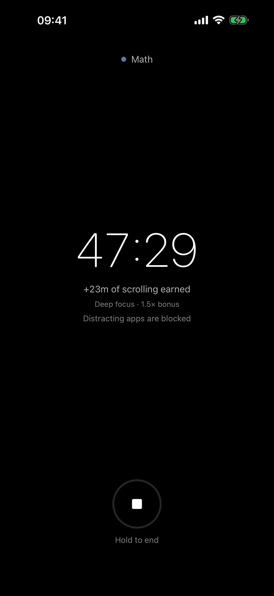
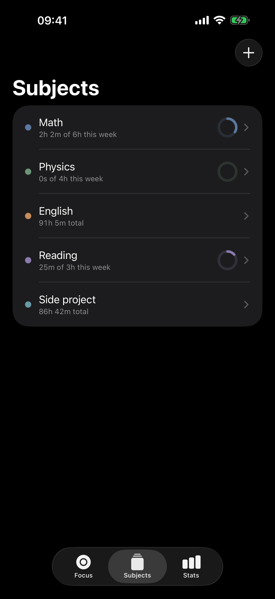

  

<h1 align="center">flowstate</h1>

  <b>Today everything is fighting for your attention. flowstate is for people who still value theirs.</b>

  

## Why flowstate

As a student, I kept losing study sessions to social media. The only thing that worked was leaving my phone in another room. Then school went digital. Assignments, schedules, and class chats all lived on my phone, so it stayed within reach, and so did the distractions. My productive sessions slowly became unproductive ones.

So I built flowstate: a simple app that helps you stay focused and actually get work done, even with your phone right next to you. It blocks the apps that distract you and keeps the ones you actually need. Whether it's for work, personal growth, or just time away from your feed, flowstate protects your focus.

## How it works

### Focus sessions
Pick a subject (Math, Reading, a side project…) and tap **Start focus**. Until you end the session, every app is blocked except:
- the apps you allowed (a calculator, a dictionary, whatever your work needs),
- Phone and emergency calls, which are never blocked,
- apps in Settings → Screen Time → Always Allowed.

Ending a session takes a deliberate 1.5-second hold, so quitting on impulse is harder.

While a session runs, it stays on your Lock Screen and in the Dynamic Island: the subject, a live timer, and three "that's like" goals filling up as you go (5× sunlight trips, 1× Beethoven's 9th, 1× Tour de France stage…).

### No quick escapes
While a session is running, the phone's date and time can't be changed, so the clock can't be wound to stretch it.

### Stats
Time focused today, this week, month and year, with a streak, a calendar of every day, and comparisons like "that's 2.6 Harry Potter movie marathons". Each subject has its own page with its history and a chart. Milestones go from your first hour up to 10,000 hours.

### Notifications
All optional, switched on and off in **Profile → Notifications**:
- **Morning nudge** (you pick a time between 4:00 and 10:00): how long you focused yesterday and on what, after days you focused.
- **Daily reminder** (you pick an afternoon time, 12:00 to 18:00): only if you haven't logged a focus session yet that day. Off until you set it up.
- **Streak protector** (any time you pick, 20:00 by default): when your streak would end at midnight.
- **Weekly recap** (last day of the week, 18:00): your total, the change from last week and your top subject. Tap it for the recap screen with a chart of the week. It's also under ✦ on the Stats tab.
- **Milestones** 🏆 and **personal bests** 🥇: shown on the session summary and saved to Notification Center.

## Privacy
Everything stays on your phone. Apple's Screen Time keeps app choices private: flowstate never learns which apps you pick, only opaque tokens for blocking them.

## App design

  
  
  
  
  

---
