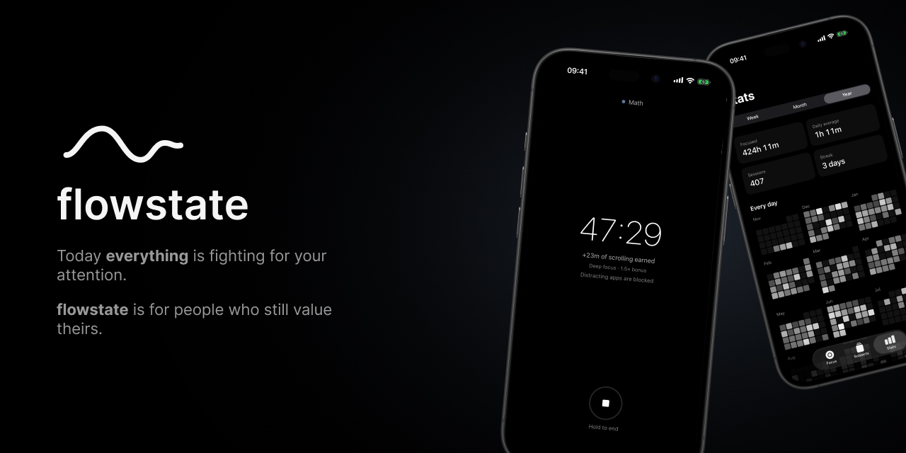
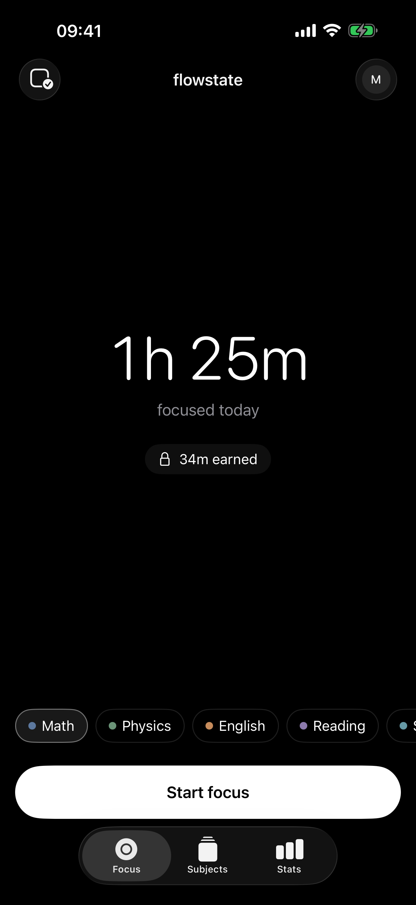
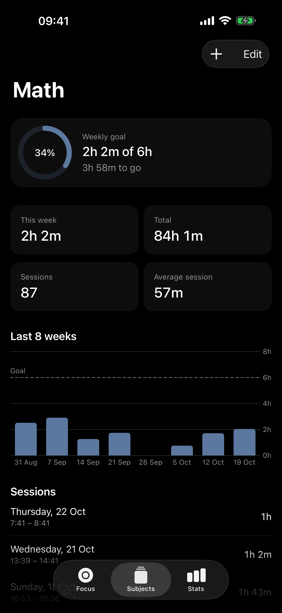
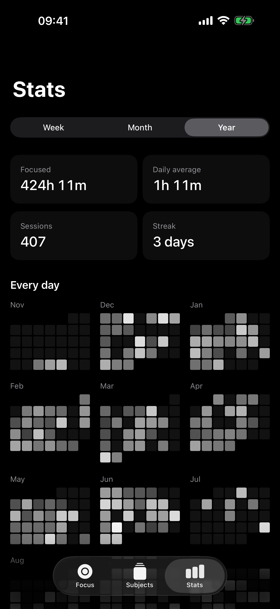

  

<h1 align="center">flowstate</h1>

  <b>Today everything is fighting for your attention. flowstate is for people who still value theirs.</b>

  

## Why flowstate

As a student, I kept losing study sessions to social media. The only thing that worked was leaving my phone in another room. Then school went digital. Assignments, schedules and class chats all lived on my phone, so it stayed within reach, and so did the distractions. My productive sessions slowly became unproductive ones.

So I built flowstate: a simple app that helps you stay focused and actually get work done, even with your phone right next to you. It blocks the apps that distract you and keeps the ones you need. Whether it's for school, work or just time away from your feed, flowstate protects your focus.

## What it does

### Focus sessions
Pick a subject (Math, Reading, a side project…) and tap **Start focus**. Until you end the session, every app is blocked except:
- the apps you allowed (a calculator, a dictionary, whatever your work needs),
- Phone and emergency calls, which are never blocked,
- apps in Settings → Screen Time → Always Allowed.

Ending a session takes a deliberate 1.5-second hold, so quitting on impulse is harder. While a session runs, the phone's date and time can't be changed, so the clock can't be wound forward to stretch it.

### On your Lock Screen
A running session stays on your Lock Screen and in the Dynamic Island. It shows the subject and a live timer, plus three "that's like" goals that fill up as you focus: 5× sunlight's trip to Earth, 1× Beethoven's 9th, 1× a Tour de France stage. It keeps counting while flowstate is closed.

### Subjects
Your subjects sit on the home screen, the ones you use most first. Tap a subject to pick it for your next session, and tap it again to see its stats. Each subject has a page with this week, its total, its average session, a chart of the last eight weeks and every session.

### Stats
Time focused today, this week, month and year, with a streak and a calendar of every day. Comparisons put the hours in perspective, like "that's 2.6 Harry Potter movie marathons". Milestones go from your first hour up to 10,000.

### Study groups
Focus together with friends or classmates. Create a group and send its invite link. Whoever taps it gets asked to join, even if they still have to install flowstate first. Inside a group you see:
- **who's focusing right now**, and for how long,
- **this week's leaderboard**, Monday to Sunday,
- **everyone's total focus time**, as a badge on their profile.

Groups need an account: Sign in with Apple, Google, or email and password. Everything else works without one.

### Notifications
All optional, switched on and off in **Profile → Notifications**:
- **Morning nudge** (a time you pick between 4:00 and 10:00): how long you focused yesterday and on what, after days you focused.
- **Daily reminder** (an afternoon time you pick, 12:00 to 18:00): only if you haven't focused yet that day. Off until you set it up.
- **Streak protector** (any time you pick, 20:00 by default): when your streak would end at midnight.
- **Weekly recap** (last day of the week, 18:00): your total, the change from last week and your top subject. Tap it for the recap with a chart of the week. It's also under ✦ on the Stats tab.
- **Milestones** 🏆 and **personal bests** 🥇: shown when a session ends and saved to Notification Center.

## Privacy
Your sessions, subjects and stats stay on your phone. Apple's Screen Time keeps your app choices private too: flowstate never learns which apps you pick, only anonymous tokens for blocking them.

If you join a study group, your group mates see four things: your name, your total focus time, your focus time this week, and whether you're focusing right now. Nothing else leaves your phone. You can delete your account at any time in **Profile → Account**. That removes it from flowstate's server and takes you out of every group, while your sessions on the phone stay.

## App design

  
  
  
  
  

